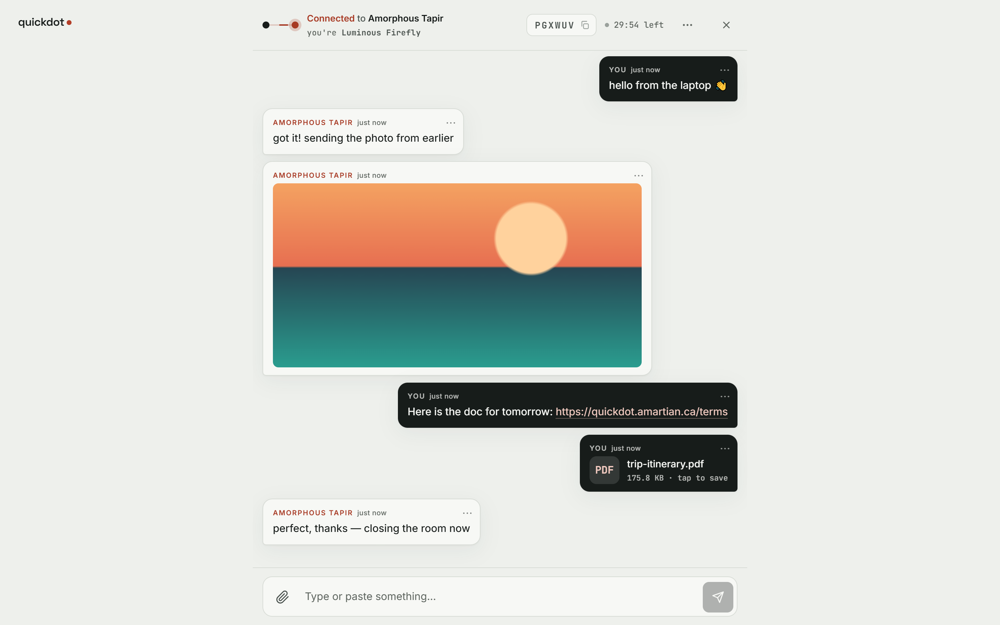
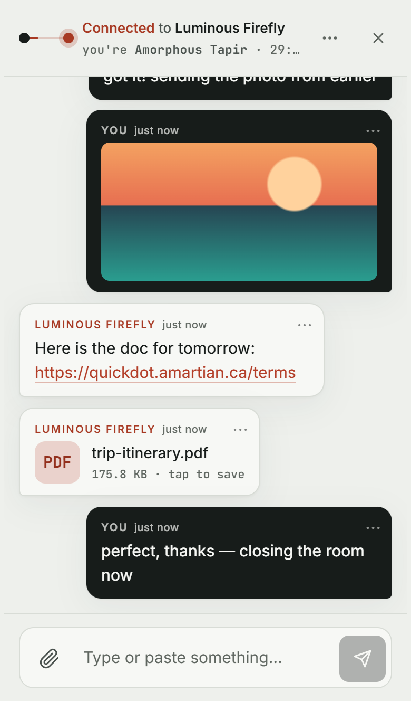
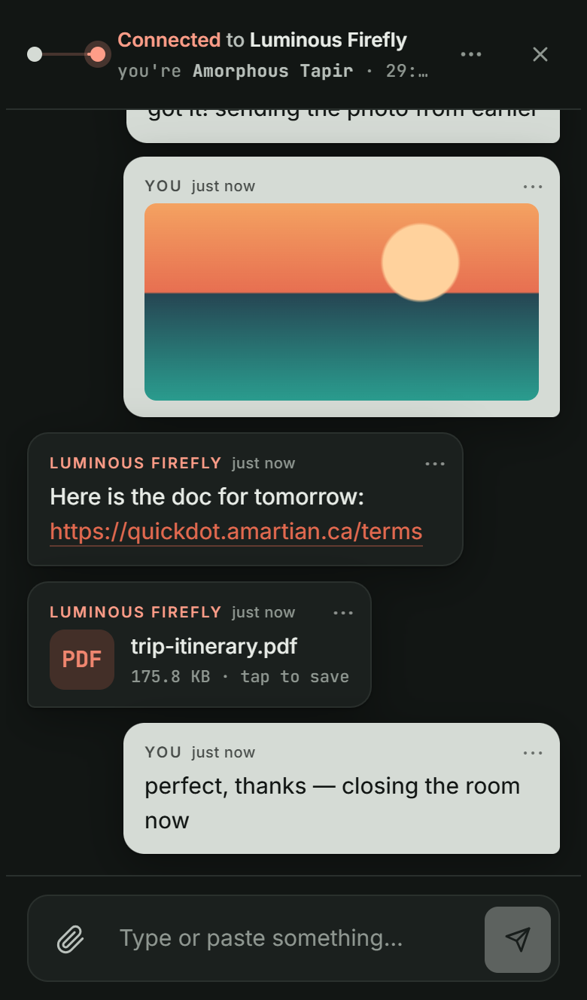
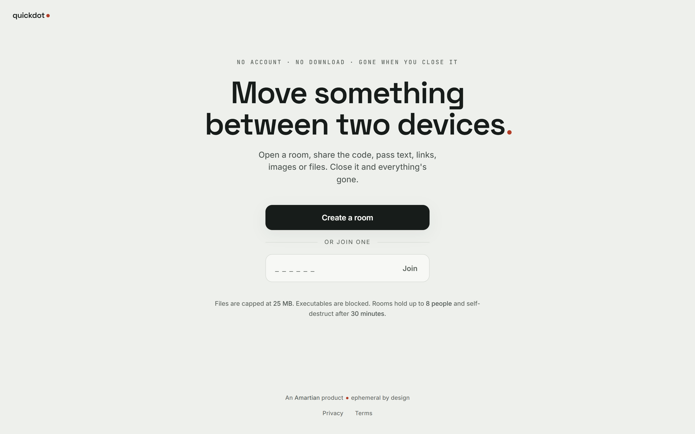
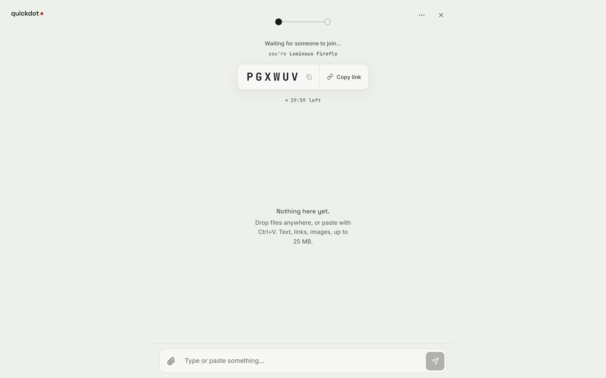
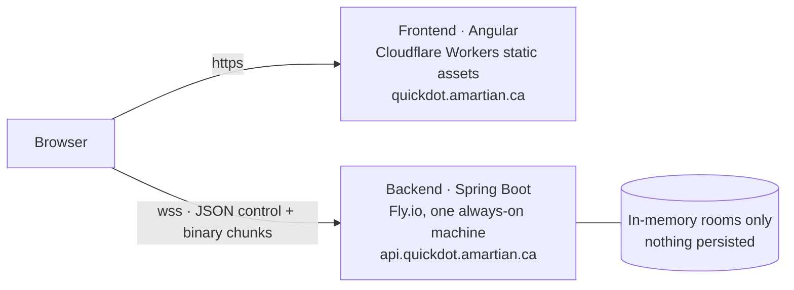

# quickdot●

**Move something between two devices. Close it and it's gone.**

[](https://github.com/jeremy25anya-web/QuickDot/actions/workflows/ci.yml)


**Live:** [quickdot.amartian.ca](https://quickdot.amartian.ca)

Open a room, share a 6-character code, and pass text, links, images or files
in real time. You don't need an account or an app, and nothing is kept. When
the room ends (someone closes it, or 30 minutes pass), nothing is left on the
server.



<table>
  <tr>
    <td width="33%"></td>
    <td width="33%"></td>
    <td width="33%"><br><br></td>
  </tr>
</table>

## Features

- **Rooms with a short code or link.** Codes use a 6-character alphabet with
  no look-alike characters (no `0/O`, `1/I/L`). Rooms hold up to 8 people.
- **Text, links, images and files** up to 25 MB, relayed live. You can paste,
  drag and drop, or use the file picker.
- **No identity.** Each participant gets a throwaway name (*Wobbly Otter*,
  *Electric Firefly*) for that room only.
- **Rooms end on their own.** Each room has a fixed 30-minute lifetime and a
  visible countdown. The host can also end it for everyone.
- **Light and dark themes**, plus *Bubbles* and *Ledger* feed layouts. These
  preferences are saved per device.
- **Built to recover.** If the connection drops, the room reconnects
  automatically and shows "Reconnecting…" while it does.
- **Accessible.** It has live-region announcements, keyboard-navigable menus
  and color tokens checked for contrast. See [`ACCESSIBILITY.md`](ACCESSIBILITY.md).

## Engineering highlights

- **Nothing is persisted.** There's no database, cache or object storage.
  Rooms live in a single in-memory map. Files stream through as 256 KB binary
  chunks and are never buffered whole or written to disk.
- **The client is never trusted.** The server enforces every limit itself:
  - a 25 MB file cap
  - blocked executable extensions
  - magic-byte MIME sniffing, which catches a renamed `.exe` while it streams
  - per-IP room-creation limits
  - text-flood throttling and upload rate limits
  - participant and item caps
  - TTL and idle timeouts
- **Load-tested against production.** [`tools/loadtest`](tools/loadtest)
  attacks each limit from a real client. The production run passed all 10
  checks with no out-of-memory errors.
- **Privacy-safe operations.** The audit log holds metadata only: a salted,
  truncated IP hash and the file's SHA-256, size and type. The SHA-256 is
  computed as a running digest while the file streams. Sentry scrubs
  exception messages on both the frontend and the backend.
- **Every decision is written down.** There are [22 ADRs](docs/DECISIONS.md),
  an [as-built architecture](docs/ARCHITECTURE.md) and the original
  [spec](SPEC.md) with its staged build plan.

## Architecture



| Layer | Stack |
|---|---|
| **Backend** | Java 21, Spring Boot 4.1, raw `WebSocketHandler` (no STOMP), Maven wrapper |
| **Frontend** | Angular 22 (standalone components, signals, zoneless), Vitest |
| **Hosting** | Fly.io (backend), Cloudflare (frontend, DNS, cookie-free Web Analytics) |
| **Ops** | GitHub Actions CI, Sentry (scrubbed), origin-locked WebSockets and CORS, strict security headers |

The backend is a modular monolith with packages organized by feature:

| Package | Responsibility |
|---|---|
| `room` | Room registry, lifecycle, TTL sweeps, per-IP creation limits |
| `ws` | WebSocket handler, sessions, protocol, keep-alive, fun names |
| `relay` | Text and file relay, chunking, rate limits, size/type/MIME checks |
| `audit` | Metadata-only audit log (hashed IPs, file digests) |
| `web` | Health check, config, CORS, security headers |
| `monitoring` | Sentry integration and scrubbing |

The WebSocket protocol, room lifecycle and file relay are covered in detail in
[`docs/ARCHITECTURE.md`](docs/ARCHITECTURE.md).

## Limits

These limits are enforced server-side. The client checks some of them too,
but only to give faster feedback.

| Rule | Limit |
|---|---|
| File size | 25 MB |
| Participants per room | 8 |
| Items per room | 200 |
| Room lifetime | 30 min from creation |
| Rooms per IP | 20 per hour, 5 open at once |
| Text messages | 30 per connection per 10 s |
| Uploads | 10 per room per minute |

## Getting started

**Prerequisites:** Java 21 and Node 22. You don't need a global Maven install,
because the Maven wrapper is committed.

```bash
# Backend: http://localhost:8080
cd backend
./mvnw spring-boot:run          # Windows: mvnw.cmd spring-boot:run

# Frontend: http://localhost:4200 (in a second terminal)
cd frontend
npm ci
npm start
```

The dev frontend expects the backend at `localhost:8080`. If that port is
taken, start the backend with `PORT=<port>` and point
`frontend/src/environments/environment.development.ts` at the same port.

### Tests

```bash
cd backend && ./mvnw verify     # backend unit + integration tests
cd frontend && npm test         # frontend tests (Vitest)
```

The load tester needs Python and runs against production by default. Point
it at a local backend with `--base`:

```bash
python tools/loadtest/loadtest.py --base http://localhost:8080
```

### Deployment

The deployment steps are in [`docs/DEPLOY.md`](docs/DEPLOY.md):

- The frontend deploys to Cloudflare.
- The backend deploys to Fly.io with `flyctl deploy`.

## Deliberate trade-offs

- **No end-to-end encryption.** Content is TLS-encrypted in transit and never
  stored, but the server relays it in memory. That is what makes the
  server-side type checks and abuse limits possible.
- **Single instance.** A restart ends the active rooms. That's acceptable for
  rooms that are temporary anyway, and it keeps v1 simple. Scaling out is on
  the [v2 list](docs/IDEAS.md).
- **No automated content scanning yet.** There is an abuse-reporting path
  instead. Hash-based scanning is the top v2 safety item.

## Repository layout

```
backend/          Spring Boot relay (room, ws, relay, audit, web, monitoring)
frontend/         Angular app
tools/loadtest/   hostile-input + load tester
docs/             architecture, ADRs, deploy runbook, open items, v2 ideas, media
legal/            privacy policy + terms (rendered into the app)
SPEC.md           the original build spec
quickdot.html     the original single-file design prototype
```

## How it was built

QuickDot was built spec-first in seven gated stages. Each stage had a written
"done when" check, and every non-trivial decision was logged as an ADR when it
was made. The code was written by an AI coding agent working under that spec
and process (see [`CLAUDE.md`](CLAUDE.md)). I set the constraints, reviewed
the work and verified each stage in production.

## Privacy and abuse

- [Privacy Policy](legal/PRIVACY-POLICY.md)
- [Terms of Service](legal/TERMS-OF-SERVICE.md)

To report abuse, use **Report** on any message in a room, or email the abuse
address listed in the Terms.

## License

© Amartian Studios. All rights reserved. The source is visible for portfolio
purposes and is not licensed for reuse.
